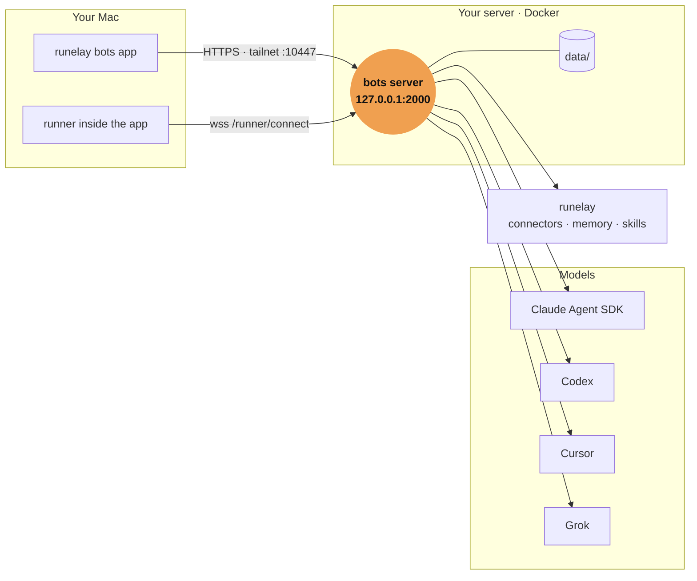
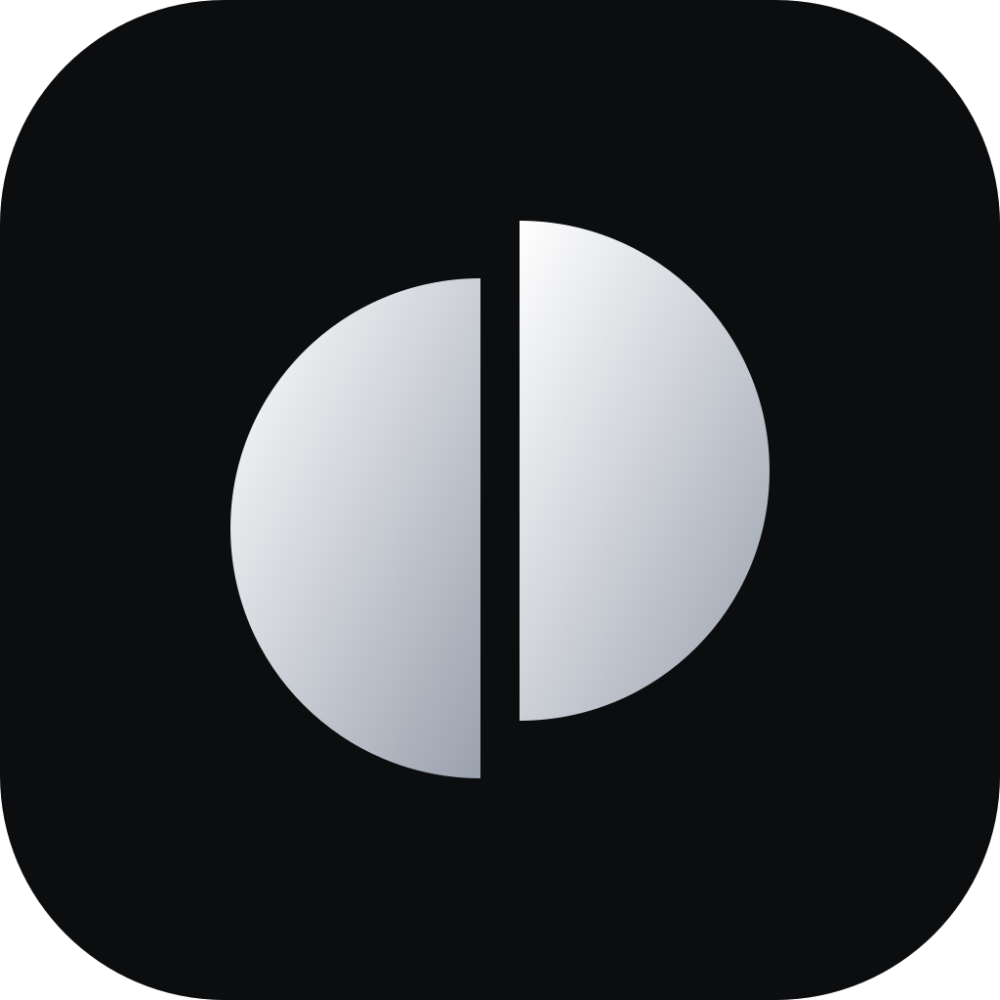

<picture>
  <source media="(prefers-color-scheme: dark)" srcset="docs/assets/banner-dark.svg" />
  
</picture>

<p align="center">
  
  
  
  
  
</p>

<p align="center">
  A team of bots that is <b>yours</b>: each one with its own instructions, model, tools and conversations.<br />
  They run on <b>your</b> server with the Claude subscription you already pay for, and you talk to them from a native Mac app.
</p>

<p align="center">
  <a href="#-quick-start"><b>Quick start</b></a> ·
  <a href="#-install-the-mac-app"><b>Mac app</b></a> ·
  <a href="docs/protocol/README.md"><b>Protocol</b></a> ·
  <a href="#-security"><b>Security</b></a>
</p>

<br />

## ✨ Why

Chat apps give you one assistant that forgets which repo it was in, cannot touch your computer, and stops when the tab closes. runelay bots is the opposite: a small team that lives on your server, keeps every conversation and worktree, and works while the Mac is closed.

The server runs each turn on the **Claude Agent SDK** logged in with your Claude subscription (or on Codex, Cursor and Grok), serves the bots their tools over MCP, and pulls connectors, memory and skills from [runelay](https://runelay.com). The Mac app is where you talk to them, watch them work and approve what they want to do.



## 🧩 What you get

| | |
|---|---|
| 💬 **Conversations per bot** | Every bot keeps a main thread plus as many conversations as you open, each with its own history, queue and worktree. Bots delegate to each other and work together in groups. |
| 🛠️ **Code mode** | A git worktree per conversation, a live diff while the bot edits, checkpoints you can rewind, and commit, push and PR with CI status right on the conversation. |
| 🖥️ **Computer use** | A browser per bot, a virtual desktop on the server, and your own Mac through the app, always with your approval. |
| 🎙️ **Voice calls** | Talk to a bot out loud: a warm fast model answers while the bot does the work, with ElevenLabs for speech. |
| 📄 **Artifacts and canvas** | Bots publish HTML pages and editable canvases, versioned, that you open and edit in the app. |
| 🔐 **Vault** | Secrets are called by alias. The value lives in the Mac keychain and only enters inside the tool, at the last moment. The model never sees it. |
| 🔌 **runelay connectors** | Linear, GitHub, Supabase and the rest of your runelay accounts, plus shared memory and skills, in every bot. |
| 🚦 **Permissions** | Read only, edit, default or full per conversation. Jev judges routine calls; anything risky waits for you. |
| 🔁 **Handoff between models** | A bot moves to its backup account when one hits its limit, carrying the context with it. |
| ⏰ **Routines and usage** | Scheduled prompts per bot, and a usage screen with limits, tokens and cost per provider. |

## 🚀 Quick start

The server runs in Docker on the VPS, from the repo root:

```sh
git clone https://github.com/<you>/runelay-bots.git && cd runelay-bots
docker compose up -d
```

No `.env` and no variable to set: data in `~/.local/share/runelay-bots`, backups in `~/.local/share/runelay-bots-backups`, your Claude Code, Codex, gh and supabase logins mounted from `$HOME`, the vault key created in the data dir. The container adapts to the uid of your HOME. Bots only touch repositories you allow: when you ask for work in a new repo, the bot asks with a card (`workspace_add`) and remembers what the repo is.

That builds `apps/server/Dockerfile`, starts the `runelay-bots` container on the host network at `127.0.0.1:2000` and keeps the bots in `~/.local/share/runelay-bots`, outside the code. Service keys are not files: ElevenLabs (voice), Jev (automatic approvals) and runelay (connectors, memory, skills) are pasted in the app under **Settings › Integrations**, validated on the spot and stored encrypted on the server. All three are optional; without one, that part turns off and everything else works. The runner token and the session secret are generated on first boot into the data dir. `tailscale serve` exposes the port on the tailnet at `:10447`.

```sh
docker compose logs -f --tail 200   # logs
docker compose restart              # restarts the server, not a rebuild
curl -s 127.0.0.1:2000/status       # never restart with a bot working
```

### Development

```sh
npm ci                     # npm workspaces: apps/server + packages/*
npm run check              # Biome: format and lint
cd apps/server
env -u CLAUDE_CONFIG_DIR GATEWAY_PORT=2100 BOTS_DATA_DIR=/path/to/data-copy BOTS_SCHEDULES=off \
  node --import tsx src/index.ts
```

A second instance on its own port and a copy of `data/` never touches production. Running a test container, env vars and the systemd rollback: [apps/server](apps/server/README.md).

## 🍎 Install the Mac app

The app is a SwiftPM package (macOS 15, Swift 6, no external dependencies). On the Mac:

```sh
cd ~/runelay-bots/mac
./scripts/make-app.sh
```

`make-app.sh` builds in release, signs with the local **runelay bots Local** certificate (so macOS keeps the microphone, speech and automation permissions between builds) and installs `~/Applications/RunelayBots.app`. From the server, sync the source first:

```sh
rsync -az --delete --exclude .build \
  apps/mac/ <seu-usuário>@<mac>:runelay-bots/mac/
```

Install an app that calls a new route only after the server with that route is up. Shortcuts, settings and pointing the app at another server: [apps/mac](apps/mac/README.md).

## 🗂️ Layout

```
apps/
  server/      Node 24 gateway: src/{index,app}.ts, config/, shared/, modules/<domain>/{routes,services,...}
  mac/         SwiftUI app: App/, Features/<domain>/, Common/, Design/, Networking/, Stores/, Models/
packages/
  providers/   Claude, Codex, Cursor and Grok adapters, process tree helpers
  protocol/    provider, event and turn types shared by server and providers
docs/
  protocol/    the verified contract, split by topic (v1 to v30)
  research/    notes behind design decisions
data/          bots, sessions, conversations, uploads, vault (git-ignored)
compose.yaml   production container
```

## 📖 Docs

- [Protocol](docs/protocol/README.md): every route, event and payload, with a version → file index
- [Contract](docs/protocol/CONTRACT.md): what the app and the server promise each other
- [Server](apps/server/README.md): run, env, layout, engine and resource limits
- [Mac app](apps/mac/README.md): build, settings and shortcuts

## 🔒 Security

- **Nothing on the internet.** The server listens on `127.0.0.1:2000`; only `tailscale serve` reaches it, on the tailnet.
- **Accounts, not an open port.** With `BOTS_AUTH=on`, every route, stream and WebSocket (including the Mac runner and voice) needs a session or an API key; only `/health` and the auth routes are open. Auth is [better-auth](https://better-auth.com): email and password, passkeys (Touch ID through the browser), revocable sessions, bearer tokens for the app and `rbk_` API keys for the runner. The first person to open a fresh server creates the owner, once; after that new people join only by an invite from the owner. Tokens live in the Mac keychain, are compared in constant time and never reach the logs, and logins are rate limited. `BETTER_AUTH_SECRET` is generated on first boot into `<data>/auth.secret` (mode 600) when missing. Details: [docs/protocol/auth.md](docs/protocol/auth.md).
- **Secrets stay out of the model.** The vault keeps values in the Mac keychain, with an optional AES-256-GCM copy on the server whose key lives outside the repo. Tools receive aliases, logs are redacted.
- **Permission modes and approvals.** Every conversation runs read only, edit, default or full. Writes outside the worktree, messages to the outside world and protected paths (`.env*`, `.ssh`, `data/`, agent configs) are denied or wait for you.
- **Your subscription, no API keys.** `ANTHROPIC_API_KEY` and friends are unset at boot; turns use the local Claude Code login.
- **Bounded.** The container is capped in memory and CPU, turns queue at three, and every process a turn starts is killed with it.

## 🗺️ Roadmap

- Break the remaining import cycle between the engine, conversations and the MCP gateway
- Tests per server module
- Measure scrolling in long conversations in fps

<br />

<p align="center">
  <br />
  runelay bots · made by <a href="https://x.com/andersonbrdev"><b>@andersonbrdev</b></a> · <a href="https://runelay.com">runelay.com</a>
</p>
