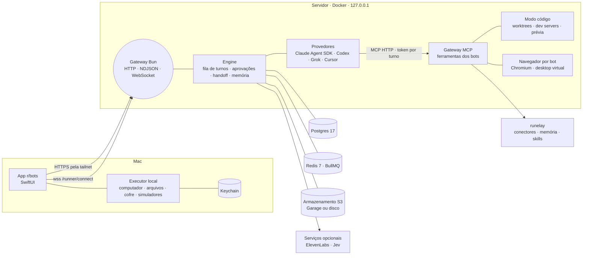
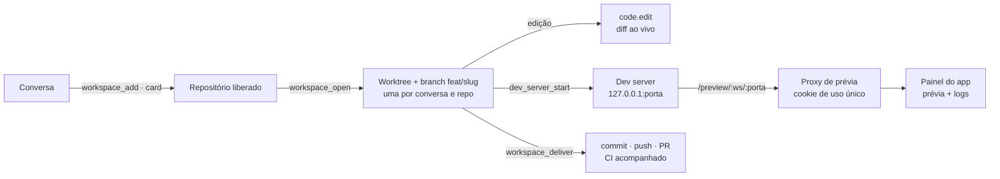
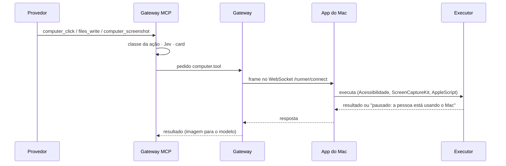

# r/bots: arquitetura

Explicação da arquitetura para mostrar em público e para quem começa a trabalhar no projeto. O contrato detalhado (rotas, eventos, corpos) está em [docs/protocol](../protocol/README.md); as regras do repositório, em [AGENTS.md](../../AGENTS.md). Endereços e nomes aqui são exemplos: `<servidor>` é a máquina onde o servidor roda, `<tailnet>` é a sua rede privada.

## Em uma frase

Um servidor Bun em Docker, na sua máquina, roda os turnos dos bots com as CLIs e o SDK dos modelos que você já assina, serve aos bots as ferramentas deles por MCP e guarda tudo em Postgres, Redis e um armazenamento de objetos. Um app nativo de macOS conversa com esse servidor pela sua rede privada e, além de interface, empresta o Mac para o que só o Mac faz (computador, Keychain, simuladores).

## Componentes



| Peça | O que é | Onde |
|---|---|---|
| App do Mac | SwiftUI, macOS 15, Swift 6, sem dependências externas. Interface, executor local e proxy MCP do Mac | `apps/mac` |
| Gateway | Bun (`Bun.serve`), roteador central em `src/app.ts`, um módulo por domínio em `src/modules/<domínio>/{routes,services,repositories}` | `apps/server` |
| Engine | Orquestra turnos: fila, slots, steer, aprovações, handoff, memória | `apps/server/src/modules/engine` |
| Gateway MCP | `POST /mcp/:botId/:sessionId`, serve as ferramentas do bot a qualquer provedor | `engine/services/mcp-gateway.service.ts` |
| Provedores | Adaptadores de Claude (Agent SDK), Codex, Grok e Cursor (CLIs) | `packages/providers` |
| Tipos compartilhados | Provedor, evento e turno, usados pelo servidor e pelos provedores | `packages/protocol` |
| Postgres | Bots, conversas, eventos, blocos, cofre (metadados), uso; busca com `tsvector` + `unaccent` | Drizzle em `apps/server/src/db` |
| Redis | Fila de jobs com BullMQ: turnos, rotinas, exportações, captura de memória, preparo de anexos; outbox transacional | `modules/jobs` |
| Armazenamento | Anexos, artefatos, canvas, fotos; driver S3 (Garage no compose) ou disco | `modules/storage` |
| runelay | Conectores (Linear, GitHub, Calendar…), memória e skills compartilhadas | `modules/connectors`, `modules/memory`, `modules/skills` |

## Rede e acesso

- O servidor escuta só em `127.0.0.1:2000`. Quem expõe é o `tailscale serve`, numa porta HTTPS da tailnet (`https://<servidor>.<tailnet>:<porta>`). Nada na internet.
- O app faz duas conexões: HTTPS para REST e streams NDJSON, e um WebSocket reverso (`/runner/connect`) por onde o servidor pede coisas ao Mac.
- Postgres, Redis e Garage escutam em loopback, com senhas geradas no primeiro boot em `<dados>/secrets/` (modo 600).

## Bots são dados

Não existe bot fixo. Um bot é uma linha com nome, rosto, cor, instruções, papel, `engine` (`account`, `model`, `effort`, reserva), capacidades (navegador, computador, delegação), rotinas, memória e modo de permissão. Servidor vazio devolve `[]`, e o app oferece "Criar seu primeiro bot". O próprio bot muda a configuração dele (e dos outros) pelas ferramentas de ajuste; subir o modo de permissão é a única mudança que sempre passa pela pessoa.

## Ciclo de um turno

```mermaid
sequenceDiagram
  autonumber
  participant App as App do Mac
  participant GW as Gateway
  participant Q as Fila (Redis)
  participant E as Engine
  participant P as Provedor (Claude SDK / CLI)
  participant M as Gateway MCP
  participant J as Jev

  App->>GW: POST {sessionBasePath}/session/:id {message, attachments, skills}
  GW->>E: entrega (delivery)
  alt turno rodando nessa conversa
    E->>E: steer: a mensagem entra no turno em curso
  else
    E->>Q: job turn.run (prioridade delegate > chat > rotina)
  end
  Q->>E: slot livre (máx. 3 turnos; voz fura a fila)
  E->>E: prompt estável + contexto da mensagem<br/>recall de memória (1x por sessão) + handoff se trocou de conta
  E->>P: query / CLI com token MCP do turno
  P->>M: chamada de ferramenta
  M->>J: ação de risco?
  alt Jev libera
    J-->>M: ok
  else precisa da pessoa
    M-->>App: interaction.opened (card ou pergunta)
    App->>GW: resposta
    GW-->>M: interaction.settled
  end
  M-->>P: resultado
  P-->>E: deltas, chamadas, uso
  E-->>App: stream NDJSON (content.delta, call.*, code.edit, server.card…)
  E->>E: turn.settled
  E->>Q: captura de memória e resumo de handoff em segundo plano
```

Pontos que importam:

- **Entrega.** Toda mensagem vira uma `delivery` com origem (`chat`, `delegate`, `schedule`, voz). O servidor emite `delivery.admitted` ao receber e `delivery.consumed` quando ela entra num turno.
- **Fila e slots.** Os turnos são jobs `turn.run` no Redis e sobrevivem a reinício. No máximo `BOTS_MAX_TURNS` (3) rodam ao mesmo tempo; os slots têm prioridade voz > delegação > chat > rotina.
- **Steer.** Mensagem de chat que chega com o turno rodando é injetada no turno em curso (o bot ajusta o que está fazendo). Se o turno está parado num card, o card fecha e a mensagem segue no lugar dele.
- **Aprovações e perguntas.** Toda ação passa por uma classe (leitura, edição, comando, entrega, mensagem para fora) e pelo modo da conversa (`readonly`, `edit`, `default`, `full`). O que não é óbvio vai ao Jev, uma camada de decisão com limiar; o resto abre `interaction.opened` com card em português. `ask_user` usa o mesmo caminho com `kind:"question"`. Card aberto vence em 600 s.
- **Handoff.** Cada conta tem a sua sessão do provedor. Quando a conversa muda de conta ou de modelo (failover no limite, troca manual), o próximo turno recebe um resumo incremental da conversa mais os itens recentes dentro de um orçamento, e o bot lê o resto com `thread_read`.
- **Failover.** Limite, conta sem login ou erro do provedor: o mesmo turno é refeito em outra conta do mesmo provedor e depois na reserva (por padrão, Codex). A volta é automática depois do reset.
- **Memória.** Antes do primeiro turno da sessão, busca no runelay o que o bot já sabe e o que o time fez hoje. Depois do turno, um job decide (Jev) se há fato durável e sem segredo e grava no runelay.
- **Rotinas.** Rodam em sessão limpa, com o resumo do resultado anterior, e caem na thread principal. Nenhuma pessoa está lá para aprovar: o que precisaria de card é negado ou decidido pelo Jev com limiar mais alto.
- **Conversas secundárias.** `/side` cria uma conversa filha que herda o contexto (fork da sessão no Claude, handoff nos outros) e as worktrees; o resultado volta para a mãe pelo mesmo caminho do steer.
- **Delegação.** O turno delegado roda na conversa do bot delegado, com a fila dele; o pedinte só vê linhas de estado. Ciclo A→B→A é recusado na hora.

## Ferramentas dos bots (MCP)

Todos os provedores recebem as ferramentas do bot pelo mesmo endpoint MCP HTTP, com um token criado para o turno e revogado no fim, preso ao bot e à sessão do caminho. O provedor Claude roda sem nada de `~/.claude` (sem CLAUDE.md, skills, hooks ou conectores locais). Grupos de ferramentas:

- conversa: `ask_user`, `request_secret`, `send_file`, `attachment_read`, `thread_*`, `delegate`
- ajustes: `settings_get`, `bot_update`, `schedule_*`, `integration_setup`, `connector_connect`…
- código: `workspace_*`, `dev_server_*`, `server_*`, `test_playwright`, `test_maestro`, `simulator_*`
- web e computador: `browser_*`, `http_request`, `computer_*`, `files_*`, `desktop_*`
- blocos: `note_*`, `sheet_*`, `agenda_*`, `export_create`, `artifact_*`, `canvas_*`
- conectores: `connector_call` para as ferramentas do runelay
- imagens: `image_cutout`
- áudio: `speech_create` (TTS da ElevenLabs com a chave da integração)

## Modo código



- Repositório só entra depois que a pessoa libera (`workspace_add`). Cada conversa tem a sua worktree e branch; uma conversa pode ter vários repositórios.
- O diff é sempre contra a base de merge da branch.
- Checkpoints por turno desfazem arquivos e conversa juntos.
- Comandos do modelo rodam num usuário separado (sandbox), com git sem hooks nem config do repositório, ambiente dos filhos por lista permitida e caminhos protegidos (`.env*`, `.ssh`, dados, configs de agente).
- Dev servers sobem em loopback, numa porta a partir de `DEV_PORT_BASE`; se um abrir em `0.0.0.0`, é derrubado. Um servidor por pasta.
- Prévia: o link `/preview/:workspace/:porta/…?t=<token>` é trocado uma vez por um cookie aleatório e o token sai da URL. O proxy tira cabeçalhos de autenticação nos dois sentidos, recusa service worker e nunca deixa a página da prévia chamar a API com a sessão da pessoa. Opcionalmente, a prévia roda num host próprio (`BOTS_PREVIEW_ORIGIN`).
- PR e CI: o servidor associa o PR à worktree pelo `HEAD` e acompanha os checks; os eventos chegam à conversa sem escopo de turno.

## Uso do computador e navegador



- **Navegador do bot** (padrão para tarefa web): um Chromium por bot no servidor, com perfil persistente, visto e operado ao vivo pelo app. `browser_open` e `http_request` só alcançam IP público, com IP fixado e sem redirecionamento.
- **Computador virtual:** desktop Xvfb por bot no servidor, ligado sob demanda e desligado ocioso.
- **Seu Mac:** o servidor não alcança o Mac; o Mac se conecta ao servidor e recebe pedidos pelo WebSocket. Observar não pede card; agir passa pelo Jev e pela pessoa, com regras fixas para o que é sempre humano (enviar, apagar, pagar, `sudo`). Na tela aparecem aura, cursor do bot e "Parar"; se a pessoa mexe no Mac, a ação pausa. Com o app em segundo plano, cards e perguntas aparecem na ilha do topo.
- **Simuladores:** o app chama `xcrun simctl` e o Maestro; o Metro roda no servidor e chega ao simulador por uma ponte TCP sobre WebSocket (`/runner/tunnel`), só para portas de servidores registrados.

## Eventos e protocolo

- **Sessão no formato do eve.** Cada bot e grupo tem um `sessionBasePath`; criar sessão, mandar mensagem, cancelar e responder card seguem essa API.
- **Stream NDJSON.** `GET …/session/:id/stream` manda linhas com eventos (`turn.*`, `content.*`, `call.*`, `interaction.*`, `code.*`, `block.*`, `delegation.updated`, `account.failover`, `settings.changed`, `test.result`…). O cursor é o número de linhas já lidas; histórico é paginado.
- **Status global.** `GET /status/stream` manda o estado de todos os bots, conversas, servidores e fila, para a lateral e os indicadores.
- **Versões.** O contrato cresce por versão (v1 a v58) e o índice [versão → arquivo](../protocol/README.md) diz onde cada mudança está. Mudou rota, evento ou ferramenta, o `docs/protocol` muda no mesmo PR. App novo só é instalado depois do servidor com a rota nova no ar.

## Segurança

- **Login sempre.** better-auth: e-mail e senha, passkey, sessões revogáveis, chaves `rbk_` para dispositivos. O primeiro a abrir um servidor vazio vira dono (com `setup.token`); depois, só por convite.
- **Rotas só do dono.** Integrações, cofre, contas, jobs, conectores e criação de bot; membro recebe 403.
- **Host conhecido.** Requisição com `Host` desconhecido recebe 421; cabeçalhos de segurança e limites de corpo e conexão.
- **Token interno** (`runner.token`) só abre `/status` e `/health`.
- **Assinatura, não API key.** `ANTHROPIC_API_KEY` e equivalentes são apagados no boot; turnos usam os logins das CLIs.
- **Cofre.** O modelo só vê apelidos. O valor fica no Keychain do Mac e é pedido pelo servidor ao app só na hora da ferramenta, com regras por site e Touch ID. Cópia opcional no servidor em AES-256-GCM (HKDF, política na AAD) com chave fora do repositório. Comandos com segredo só por um helper com tíquete de uso único. Valores conhecidos viram `••••` em eventos, logs e saídas.
- **Guarda de produção.** Deploy, escrita em banco de produção, dinheiro e mensagem para fora passam pelo Jev com limiar alto ou pela pessoa, também em Acesso total. Regras fixas negadas sempre: assinatura de IA em commit e `push --force` em branches principais.
- **Conteúdo do usuário isolado.** Tipo do anexo pelos bytes, download com CSP sandbox, artefatos com CSP restrita, PDF sem JavaScript, planilhas sem fórmulas perigosas.
- **Limites.** Container com teto de memória e CPU; todo processo de um turno morre com ele; varredura de órfãos.

## Deploy (alto nível)

1. Numa máquina Linux com Docker e Tailscale: `git clone` do repositório e `docker compose up -d`. Sem `.env` obrigatório: o compose sobe servidor, Postgres, Redis, Garage e os bootstraps de segredo; os dados ficam fora do código (`~/.local/share/runelay-bots`).
2. Logar as CLIs no host (`claude`, `codex`, `gh`, `supabase`, `wrangler`); o compose monta esses logins no container. Cada pasta `~/.claude*`/`~/.codex*` logada vira uma conta.
3. `tailscale serve` expõe `127.0.0.1:2000` numa porta HTTPS da tailnet.
4. No Mac: `apps/mac/scripts/make-app.sh` compila, assina e instala o app; apontar o perfil de servidor para o endereço da tailnet e criar o dono.
5. Integrações (ElevenLabs, Jev, runelay) são coladas no app e guardadas cifradas no servidor; todas opcionais.
6. Atualizar: `docker compose up -d --build` com nenhum turno rodando (`curl -s 127.0.0.1:2000/status`). Backups diários do banco em `~/.local/share/runelay-bots-backups`.

## Onde começar a ler o código

| Quer entender | Comece por |
|---|---|
| Como uma rota chega ao domínio | `apps/server/src/app.ts` |
| Um turno de ponta a ponta | `modules/engine/services/engine.service.ts`, `turn-queue.service.ts`, `turn-slots.service.ts` |
| As ferramentas dos bots | `modules/engine/services/mcp-gateway.service.ts`, `bot-tools.service.ts` |
| Aprovações e Jev | `modules/approvals` |
| Handoff e conversas | `modules/conversations/services/handoff.service.ts` |
| Modo código | `modules/code`, `modules/servers` |
| O Mac como executor | `apps/mac/Sources/RunelayBots/Features/Computer/Executor`, `modules/accounts` (WebSocket do runner) |
| O estado do app | `apps/mac/Sources/RunelayBots/Stores/AppModel.swift`, `Networking/` |
